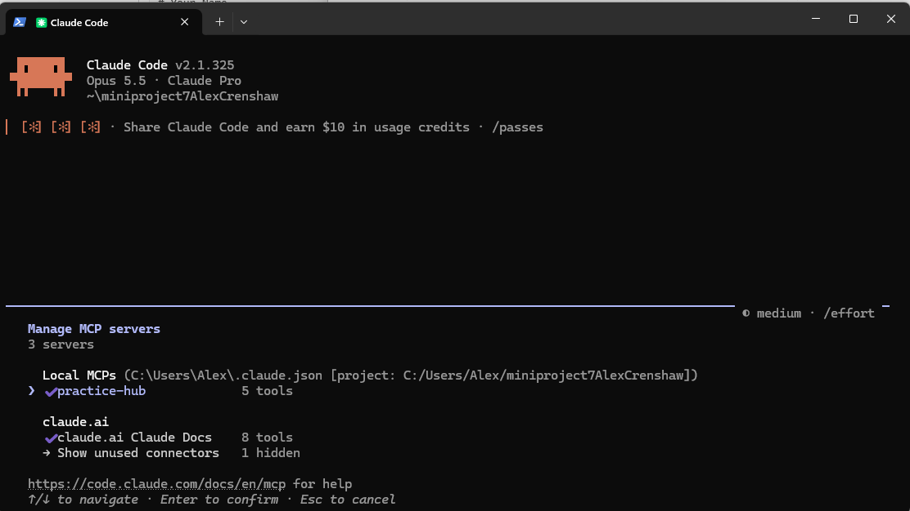

# Mini Project 7 – Practice Hub MCP Server

INF601 – Advanced Programming in Python · Alex Crenshaw

An MCP (Model Context Protocol) server, written with **FastMCP** from the
official [`mcp` Python SDK](https://github.com/modelcontextprotocol/python-sdk),
that wraps the class **Practice Hub** REST API (`https://practice.fhsucyber.com`).
Once it's registered with Claude Code, Claude can read, create, edit, and
delete your own posts on the hub by calling the server's tools. These are the
same endpoints I called by hand in Mini Project 1.

## What the server does

`server.py` exposes five tools. Each one calls one API endpoint and
authenticates with your token (`Authorization: Bearer <token>`):

| Tool | What it does | API endpoint |
| --- | --- | --- |
| `list_posts(mine, tag, author, limit, offset)` | List posts. `mine=True` returns only your posts | `GET /api/v1/posts` |
| `get_post(post_id)` | Get one post by id | `GET /api/v1/posts/{id}` |
| `create_post(title, body, tags)` | Create a new post | `POST /api/v1/posts` |
| `update_post(post_id, title, body, tags)` | Edit one of your posts. Only the fields you pass change | `PATCH /api/v1/posts/{id}` |
| `delete_post(post_id)` | Delete one of your posts | `DELETE /api/v1/posts/{id}` |

Each tool has a docstring that explains when to use it and what each argument
means. Claude reads these docstrings to decide which tool to call.

### Error handling

Every request goes through one `_request()` helper that **never raises**.
When something goes wrong, the tool sends back a clear message, the server
keeps running, and Claude can explain the problem to the user:

| Situation | Message the tool returns |
| --- | --- |
| `PRACTICE_API_TOKEN` not set | Explains that the token is missing and how to set it |
| 401 | Token missing or invalid. Check `PRACTICE_API_TOKEN` |
| 403 | You can only edit or delete posts that you created |
| 404 | No post exists with that id |
| 422 | The API's validation message (for example, an empty title) |
| Other HTTP error | Status code plus the API's `detail` message |
| Network failure or timeout | "Could not reach the Practice Hub at …" |
| `update_post` called with nothing to change | Asks for at least one field |

The server uses stdio transport, so stdout is reserved for MCP protocol
messages. Warnings go to stderr.

## Requirements

- Python 3.10 or newer (developed on 3.11)
- Packages in `requirements.txt`:
  - `mcp` (pinned below 2.0, because mcp 2.x renamed `FastMCP` to `MCPServer`)
  - `httpx`, the HTTP client
  - `truststore`, which makes HTTPS verification use your operating system's
    certificate store. This keeps the server working behind antivirus HTTPS
    scanning (such as Avast) or a school or corporate proxy.

## Install

```powershell
git clone https://github.com/rojomoon17/miniproject7AlexCrenshaw.git
cd miniproject7AlexCrenshaw
python -m venv .venv
.venv\Scripts\Activate.ps1          # macOS/Linux: source .venv/bin/activate
pip install -r requirements.txt
```

## Set the environment variables

| Variable | Required | Default |
| --- | --- | --- |
| `PRACTICE_API_TOKEN` | yes | none (never hard-coded) |
| `PRACTICE_API_URL` | no | `https://practice.fhsucyber.com` |

**Windows PowerShell**

```powershell
$env:PRACTICE_API_TOKEN = "your-token-here"
$env:PRACTICE_API_URL   = "https://practice.fhsucyber.com"
```

**macOS / Linux**

```bash
export PRACTICE_API_TOKEN="your-token-here"
export PRACTICE_API_URL="https://practice.fhsucyber.com"
```

The token is read from `os.environ` and never appears in the code. `.gitignore`
excludes `.env` and `secrets*` files, so a secrets file can't be committed by
accident.

## Register the server with Claude Code

Run this from the project folder in PowerShell, after setting
`$env:PRACTICE_API_TOKEN` above:

```powershell
claude mcp add practice-hub -e PRACTICE_API_URL=https://practice.fhsucyber.com -e PRACTICE_API_TOKEN=$env:PRACTICE_API_TOKEN -- "$PWD\.venv\Scripts\python.exe" "$PWD\server.py"
```

On macOS / Linux:

```bash
claude mcp add practice-hub -e PRACTICE_API_URL=https://practice.fhsucyber.com -e PRACTICE_API_TOKEN="$PRACTICE_API_TOKEN" -- "$PWD/.venv/bin/python" "$PWD/server.py"
```

- `-e` passes the environment variables to the server process. Claude Code
  stores them in your local Claude config (`~/.claude.json`), not in this repo.
- Everything after `--` is the command Claude Code runs to start the server
  over stdio. Using the venv's Python makes sure `mcp` and `httpx` are available.

Check that it connected:

```powershell
claude mcp list        # practice-hub should show "✔ Connected"
```

To remove it later: `claude mcp remove practice-hub`.

## Acceptance test (read → create → modify)

1. Start Claude Code in this folder: `claude`
2. Type `/mcp` and confirm that `practice-hub` is connected and lists its 5 tools.
3. Give Claude these prompts. Approve each tool call when it asks:
   1. **Read:** `Using the practice-hub server, list my posts.`
      Claude calls `list_posts(mine=true)`.
   2. **Create:** `Create a new post titled "Hello from my MCP server" with body "Created by Claude Code through my Mini Project 7 server." and tags mcp and inf601.`
      Claude calls `create_post`.
   3. **Modify:** `Update that post's body to say it was edited through MCP, and add the tag edited.`
      Claude calls `update_post` with the new post's id.
   4. **Verify:** `Get that post again so I can see the change.`
      Claude calls `get_post`.
4. Optional error check: ask Claude to edit a post that belongs to someone
   else. The tool returns the 403 message and the server keeps running.

### Evidence

- **Transcript:** [`docs/acceptance-test.md`](docs/acceptance-test.md) records
  a headless Claude Code run that used only this server's tools. It lists my
  posts, creates post #62, edits it, reads it back, and shows the 404 message.
  It also shows the 403 and 422 checks.
- **Screenshots** from my own interactive Claude Code session, in
  [`docs/screenshots/`](docs/screenshots/):

| Screenshot | What it shows |
| --- | --- |
| [01-mcp-servers-connected.png](docs/screenshots/01-mcp-servers-connected.png) | `/mcp`: `practice-hub` is connected with 5 tools |
| [02-practice-hub-server-details.png](docs/screenshots/02-practice-hub-server-details.png) | Server status, the command Claude Code runs, and the config location |
| [03-practice-hub-tools.png](docs/screenshots/03-practice-hub-tools.png) | The five tools: `list_posts`, `get_post`, `create_post`, `update_post`, `delete_post` |
| [04-list-posts-tool.png](docs/screenshots/04-list-posts-tool.png) | `list_posts` docstring and parameters as Claude sees them |
| [05-create-post-tool.png](docs/screenshots/05-create-post-tool.png) | `create_post` docstring and parameters |
| [06-update-post-tool.png](docs/screenshots/06-update-post-tool.png) | `update_post` docstring and parameters |
| [07-delete-post-tool.png](docs/screenshots/07-delete-post-tool.png) | `delete_post` docstring and parameters |
| [08-read-list-my-posts.png](docs/screenshots/08-read-list-my-posts.png) | **Read step:** I asked Claude to list my posts. It called `practice-hub` and showed posts #62 and #8 |



## AI Usage

I built this project with Claude Code (Claude Opus 5.5), following the INF601
AI Use Policy.

### Claude Code (AI)

- Read my Mini Project 1 client and the Practice Hub API schema to find the
  endpoints and fields.
- Created the project folder, virtual environment, and git repository.
- Worked around Avast's HTTPS scanning, which was breaking `pip`, by
  downloading the packages with `curl`.
- Wrote all of `server.py`: the five FastMCP tools, their docstrings, and the
  error handling. The error handling is based on the `_check()` method from
  my Mini Project 1. Claude also added `truststore` so HTTPS works behind Avast.
- Wrote `requirements.txt`, `.gitignore`, and this README, including the
  Evidence section and this AI Usage section.
- Tested the error handling (missing token, 401, 403, 404, 422, network
  failure).
- Ran the `claude mcp add` registration with my token. My first attempt
  failed because I left out `PRACTICE_API_TOKEN=`, and Claude corrected it.
- Ran the acceptance test in a headless Claude Code session (list my posts,
  create post #62, edit it, read it back, 404 check) and wrote
  `docs/acceptance-test.md` from that session.
- Made all of the commits, pushed to GitHub, and copied my screenshots from
  my Google Doc into `docs/screenshots/`.

### Me (Alex Crenshaw)

- Gave Claude the assignment rubric and directed the work.
- Created the GitHub repository.
- Supplied my Practice Hub API token and attempted the `claude mcp add`
  command.
- Asked Claude for review suggestions. Following one of them, I ran Claude
  Code interactively and took the screenshots in `docs/screenshots/`,
  showing the server connected and its tools.
- Ran the read step of the acceptance test myself ("list my posts using the
  practice hub server") and uploaded the screenshot
  (`08-read-list-my-posts.png`) to GitHub.
